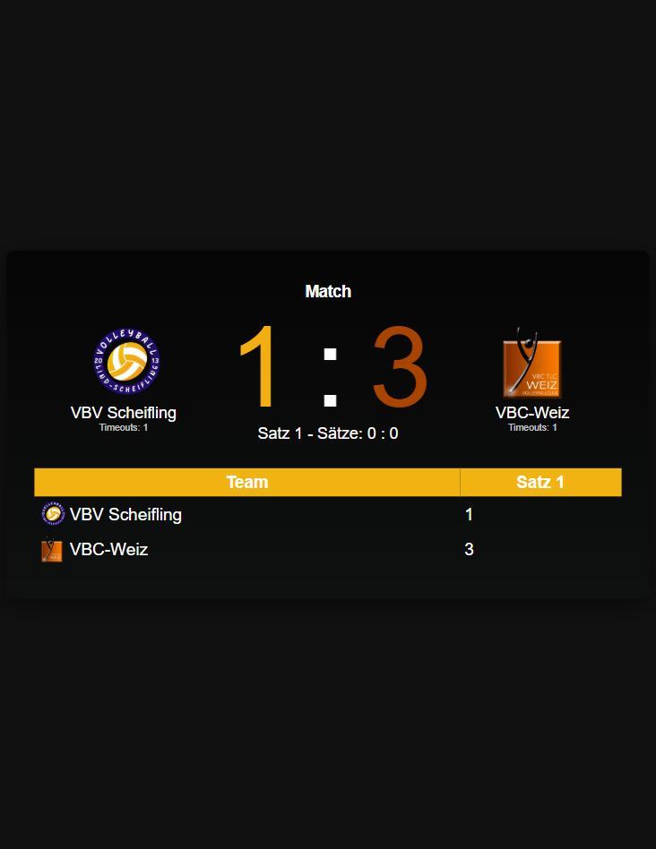
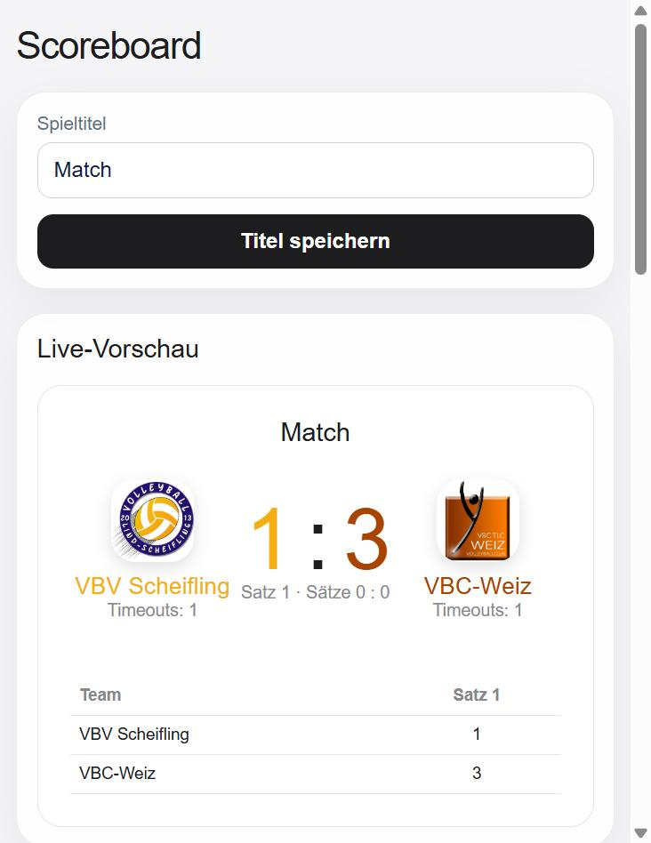

# Scoreboard

Digitale Anzeigetafel für Volleyball-Spiele. Eine öffentliche Anzeigeseite zeigt
den aktuellen Spielstand in Echtzeit, ein passwortgeschütztes Steuerpult bedient
Punkte, Sätze, Timeouts und das Layout.

## Screenshots

| Anzeige | Steuerpult | Mobile-Ansicht |
|---------|------------|----------------|
|  |  |  |

## Funktionen

- Live-Anzeige von Punkten, Sätzen und Satzverlauf
- Steuerpult für Punkte +/-, Satzgewinn, Timeouts und Seitenwechsel
- Team-Namen, Farben und hochgeladene Logos
- Spieltitel und Kopfzeilenfarbe frei einstellbar
- Timeout- und Pausen-Countdown
- Rückgängig-Funktion für die letzte Aktion
- Als PWA installierbar (`manifest.json`)

## Technik

PHP, MySQL (PDO), HTML, CSS und JavaScript. Läuft lokal unter XAMPP.

## Aufbau

| Datei             | Zweck                                             |
|-------------------|---------------------------------------------------|
| `index.php`       | öffentliche Anzeigeseite, fragt den Stand ab      |
| `admin.php`       | Steuerpult, passwortgeschützt                     |
| `update.php`      | nimmt Änderungen entgegen (CSRF-geschützt)        |
| `get_score.php`   | liefert den aktuellen Stand als JSON              |
| `db.php`          | Datenbankverbindung                               |
| `schema.sql`      | Tabellenstruktur                                  |
| `assets/`         | Stylesheet und Skript                             |

## Einrichtung

1. Projekt nach `C:\xampp\htdocs\Scoreboard` kopieren, Apache und MySQL starten.
2. In phpMyAdmin eine Datenbank `scoreboard_db` anlegen und `schema.sql` importieren.
3. Bei Bedarf die Zugangsdaten in `db.php` anpassen (Standard: `localhost`, `root`, kein Passwort).
4. Admin-Passwort über die Umgebungsvariable `SCOREBOARD_ADMIN_PASSWORD` setzen.
   Ohne gesetzte Variable gilt der Platzhalter `changeme` – vor dem Einsatz unbedingt ändern.
5. Anzeige öffnen: `http://localhost/Scoreboard/`
   Steuerpult: `http://localhost/Scoreboard/admin.php`

## Hinweis

Hochgeladene Logos landen im Ordner `uploads/` und werden nicht mitversioniert.
